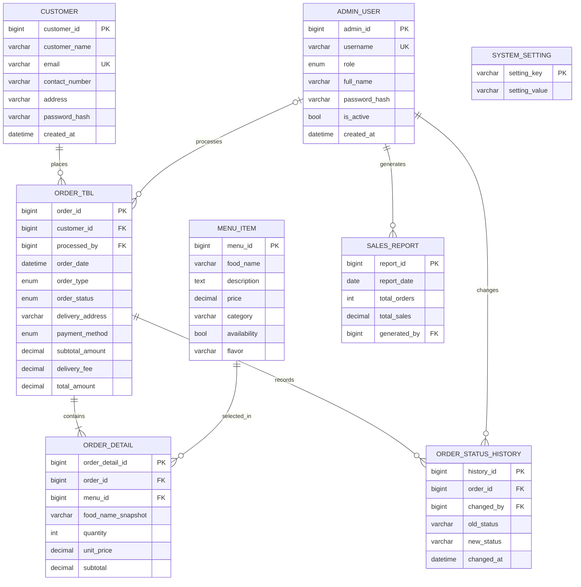

# Updated entity-relationship diagram

The six original entities from the project's proposed ERD are retained. The two added entities are labelled as additions.

`SYSTEM_SETTING` is a standalone lookup table for the fixed delivery fee. It does not need a foreign key; the server reads it while calculating an order.

All money fields use `DECIMAL` in MySQL. Stored order line prices and names are snapshots to protect historical receipts if menu prices or titles change. Reports are dated snapshots generated by staff, based on completed orders only.
